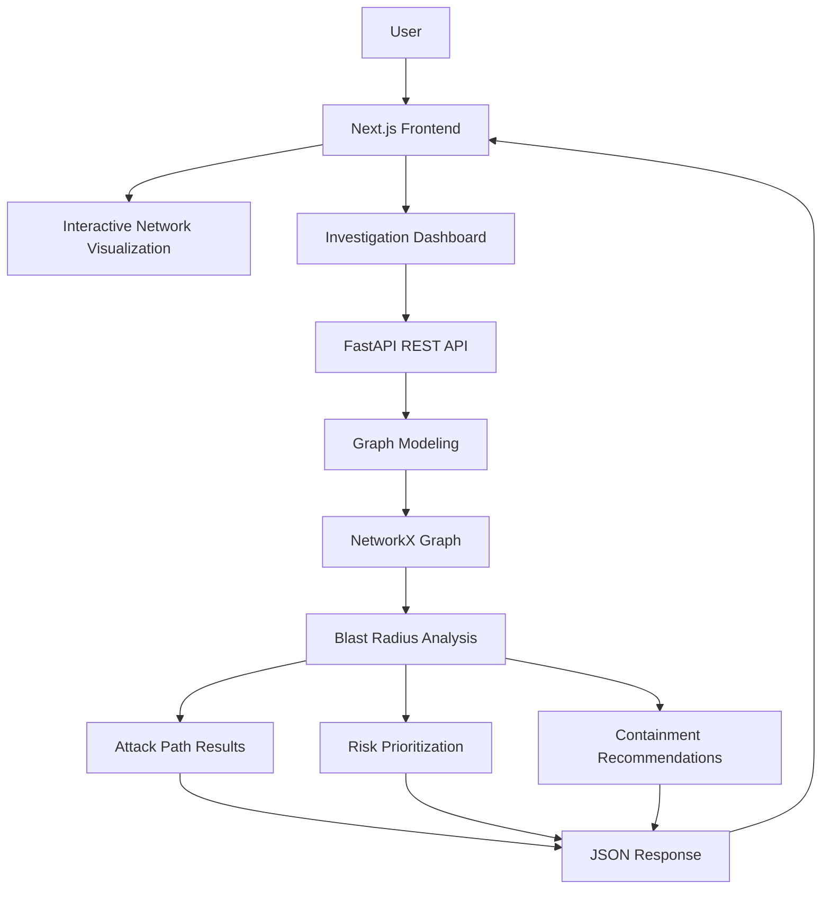

# BlastGuard
### Graph-Based Cyber Threat Hunting and Blast Radius Analysis

**See the connections. Expose the impact.**

BlastGuard is a graph-based cybersecurity analysis platform designed to investigate potential threat propagation across enterprise networks. It models infrastructure as interconnected assets and relationships, helping security analysts identify exposed systems, explore potential attack paths, prioritize risks, and review containment recommendations.

<p align="center">
  <a href="https://blast-guard.vercel.app/">
    
  </a>
  <a href="https://blast-guard.onrender.com">
    
  </a>
  <a href="https://blast-guard.onrender.com/docs">
    
  </a>
</p>

---

## Live Application

| Component | URL |
|---|---|
| BlastGuard Frontend | https://blast-guard.vercel.app/ |
| Investigation Dashboard | https://blast-guard.vercel.app/graph |
| FastAPI Backend | https://blast-guard.onrender.com |
| API Documentation | https://blast-guard.onrender.com/docs |
| Health Check | https://blast-guard.onrender.com/health |

---

## Table of Contents

- [Overview](#overview)
- [Problem Statement](#problem-statement)
- [Key Features](#key-features)
- [Application Screenshots](#application-screenshots)
- [System Architecture](#system-architecture)
- [Technology Stack](#technology-stack)
- [How BlastGuard Works](#how-blastguard-works)
- [Graph Analysis Methodology](#graph-analysis-methodology)
- [Project Structure](#project-structure)
- [Getting Started](#getting-started)
- [API Reference](#api-reference)
- [Example Investigation](#example-investigation)
- [Testing](#testing)
- [Limitations](#limitations)
- [Future Enhancements](#future-enhancements)
- [License](#license)

---

## Overview

Modern enterprise environments consist of interconnected workstations, user accounts, identity providers, applications, databases, and other infrastructure components.

A compromise involving one asset may create potential exposure across other connected systems.

BlastGuard approaches this problem using graph-based analysis.

The platform represents an enterprise network as a directed graph:

- **Nodes** represent infrastructure assets.
- **Edges** represent relationships between assets.
- **Traversal algorithms** identify potentially reachable assets.
- **Risk scoring** helps prioritize exposed infrastructure.
- **Containment recommendations** provide defensive guidance.

By combining network visualization with graph analysis, BlastGuard provides an interactive environment for investigating potential attack propagation and understanding its impact.

## Problem Statement

Traditional security monitoring often presents assets, alerts, and events individually. However, understanding the potential impact of a security incident requires examining how these entities are connected.

Security analysts may need to determine:

- Which assets could be exposed following an initial compromise?
- How could a threat propagate through connected infrastructure?
- Which reachable assets have the highest criticality?
- What potential attack paths connect the initial asset to other systems?
- Which defensive actions should be prioritized?

BlastGuard addresses these questions by modeling enterprise infrastructure as a graph and analyzing potential reachability from a selected starting asset.

---

## Key Features

### 1. Interactive Network Visualization

Explore an enterprise network through an interactive graph visualization.

- Visualize infrastructure assets and relationships.
- Select individual nodes.
- Inspect asset attributes and criticality.
- Explore the modeled network topology.
- Highlight assets associated with blast-radius analysis.

### 2. Blast Radius Analysis

Investigate the potential impact of a compromised asset.

- Select a starting asset.
- Configure maximum traversal depth.
- Identify reachable assets.
- Calculate hop distances.
- Review an exposure summary.

### 3. Attack Path Discovery

Investigate potential paths connecting the starting asset to exposed infrastructure.

- Inspect paths to reachable assets.
- Examine relationships along a path.
- Review traversal depth.
- Select exposed assets for further investigation.

### 4. Risk Prioritization

Prioritize exposed assets using heuristic risk scores.

- Risk-ranked asset results.
- Critical, High, Medium, and Low classifications.
- Risk distribution visualization.
- Individual asset risk breakdown.
- Asset criticality and exposure context.

### 5. Attack Scenario Simulation

Use predefined scenarios to perform repeatable investigations.

Available scenarios include:

- Finance Workstation Compromise.
- Privileged Account Compromise.
- HR Workstation Compromise.
- Production Database Incident.

Each scenario defines a starting asset and a traversal depth.

### 6. Containment Recommendations

Generate rule-based containment recommendations from analysis results.

These recommendations help analysts identify potential defensive actions and prioritize their investigation.

Recommendations are advisory. BlastGuard does not automatically isolate systems or modify infrastructure.

---

## System Architecture

BlastGuard follows a frontend-backend architecture.



### Architecture Components

**Frontend — Next.js**

Provides the user interface, landing page, investigation dashboard, analysis controls, and visualization of results.

**Backend — FastAPI**

Exposes REST endpoints for graph retrieval, graph analysis, and blast-radius investigation.

**Graph Processing — NetworkX**

Handles graph construction, directed relationships, and graph-based reachability analysis.

**Network Visualization — Cytoscape.js**

Provides interactive visualization of enterprise network topology.

**Data Validation — Pydantic**

Validates graph data and analysis request payloads.

---

## Technology Stack

| Layer | Technologies |
|---|---|
| Frontend Framework | Next.js |
| UI Library | React |
| Language | JavaScript |
| Styling | Tailwind CSS |
| Backend Framework | FastAPI |
| Backend Language | Python |
| Graph Processing | NetworkX |
| Graph Visualization | Cytoscape.js |
| Data Validation | Pydantic |
| API Communication | REST, JSON |
| Frontend Deployment | Vercel |
| Backend Deployment | Render |

---

## How BlastGuard Works

The investigation process consists of four stages.

### 1. Model

Represent enterprise infrastructure as a directed graph.

Nodes contain asset information such as:

- Asset ID
- Label
- Type
- Criticality
- Compromised status
- Additional properties

Relationships contain:

- Source asset
- Target asset
- Relationship type
- Confidence value

### 2. Investigate

Choose an initial asset for investigation.

The analyst can either select an asset manually or choose a predefined attack scenario.

A maximum traversal depth controls how far the analysis explores the graph.

### 3. Analyze

The backend constructs the graph and performs directed reachability analysis.

The analysis identifies potentially exposed assets and calculates contextual information such as hop distance, paths, and heuristic risk scores.

### 4. Respond

The dashboard presents the results through:

- Threat overview.
- Exposed asset list.
- Attack paths.
- Risk distribution.
- Asset-level risk breakdown.
- Containment recommendations.

---

## Graph Analysis Methodology

### Graph Representation

BlastGuard models enterprise infrastructure as a directed graph:

\[
G=(V,E)
\]

Where:

- \(V\) represents the set of infrastructure assets.
- \(E\) represents the set of directed relationships between assets.

Each edge can include a relationship type and confidence value.

### Blast Radius Analysis

Given a starting asset \(s\) and maximum traversal depth \(h\), the analysis identifies assets reachable from \(s\).

\[
R(s,h)=\{v\in V \mid d(s,v)\leq h\}
\]

Where:

- \(s\) is the starting asset.
- \(v\) is a reachable asset.
- \(d(s,v)\) is the shortest directed path distance.
- \(h\) is the maximum traversal depth.

The resulting set represents potential exposure within the modeled network.

### Risk Classification

BlastGuard uses heuristic risk scores to help prioritize exposed assets.

| Risk Score | Classification |
|---|---|
| 80–100 | Critical |
| 60–79 | High |
| 35–59 | Medium |
| 0–34 | Low |

These classifications provide a prioritization mechanism for investigation. They should not be interpreted as calibrated probabilities of compromise.

---

## Project Structure

```text
blast-guard/
│
├── backend/
│   ├── app/
│   │   ├── data/
│   │   │   ├── __init__.py
│   │   │   └── sample_network.py
│   │   │
│   │   ├── graph/
│   │   │   ├── __init__.py
│   │   │   ├── blast_radius.py
│   │   │   ├── builder.py
│   │   │   ├── recommendations.py
│   │   │   └── traversal.py
│   │   │
│   │   ├── models/
│   │   │   ├── __init__.py
│   │   │   └── graph_models.py
│   │   │
│   │   ├── __init__.py
│   │   └── main.py
│   │
│   ├── .python-version
│   ├── requirements.txt
│   ├── test_blast_radius.py
│   ├── test_builder.py
│   ├── test_sample_api.py
│   ├── test_sample_network.py
│   ├── test_traversal.py
│   └── test_visualization_api.py
│
├── public/
│   └── favicon.ico
│
├── src/
│   ├── components/
│   │   ├── AttackPathPanel.js
│   │   ├── AttackScenarioSelector.js
│   │   ├── BlastRadiusPanel.js
│   │   ├── BlastRadiusResults.js
│   │   ├── ContainmentRecommendations.js
│   │   ├── NetworkGraph.js
│   │   ├── RiskBreakdown.js
│   │   ├── RiskDistribution.js
│   │   └── ThreatOverview.js
│   │
│   ├── pages/
│   │   ├── _app.js
│   │   ├── _document.js
│   │   ├── graph.js
│   │   └── index.js
│   │
│   └── styles/
│       └── globals.css
│
├── .gitignore
├── eslint.config.mjs
├── jsconfig.json
├── next.config.mjs
├── package.json
├── package-lock.json
└── README.md
```

---

## Getting Started

Follow these instructions to run BlastGuard locally.

### Prerequisites

- Python 3.13.1
- Node.js
- npm
- Git

### 1. Clone the Repository

```bash
git clone https://github.com/MeSanskarSingh/blast-guard
cd blast-guard
```

### 2. Set Up the Backend

Navigate to the backend directory:

```bash
cd backend
```

Create a virtual environment:

```bash
python -m venv venv
```

Activate the environment.

**Windows PowerShell**

```powershell
venv\Scripts\Activate.ps1
```

**Linux/macOS**

```bash
source venv/bin/activate
```

Install the dependencies:

```bash
pip install -r requirements.txt
```

Start the FastAPI development server:

```bash
uvicorn app.main:app --reload
```

The backend will be available at:

```text
http://127.0.0.1:8000
```

Interactive API documentation:

```text
http://127.0.0.1:8000/docs
```

### 3. Set Up the Frontend

Open another terminal and navigate to the project root.

Install dependencies:

```bash
npm install
```

Create a `.env.local` file in the root directory:

```env
NEXT_PUBLIC_API_BASE_URL=http://127.0.0.1:8000
```

Start the Next.js development server:

```bash
npm run dev
```

If your environment requires Webpack instead of Turbopack:

```bash
npm run dev -- --webpack
```

The frontend will be available at:

```text
http://localhost:3000
```

### 4. Explore the Application

| Route | Description |
|---|---|
| `/` | BlastGuard landing page |
| `/graph` | Interactive investigation dashboard |

Both the backend and frontend must be running for the complete local application to work.

---

## API Reference

BlastGuard exposes REST endpoints through FastAPI.

**Base URL**

```text
https://blast-guard.onrender.com
```

| Method | Endpoint | Description |
|---|---|---|
| GET | `/` | Backend welcome message |
| GET | `/health` | Health check |
| POST | `/api/graph/analyze` | Analyze graph structure |
| GET | `/api/graph/sample` | Retrieve sample network data |
| GET | `/api/graph/visualization` | Retrieve graph elements and summary |
| POST | `/api/blast-radius/analyze` | Perform blast-radius analysis |

### Health Check

```http
GET /health
```

Returns the service health status and API version.

### Graph Visualization

```http
GET /api/graph/visualization
```

Returns the sample enterprise network in a Cytoscape-compatible format, along with graph summary information.

### Blast Radius Analysis

```http
POST /api/blast-radius/analyze
Content-Type: application/json
```

Example request:

```json
{
  "graph": {
    "nodes": [],
    "relationships": []
  },
  "compromised_node": "WS-042",
  "max_hops": 4
}
```

The graph arrays should contain the actual node and relationship objects expected by the backend schemas.

A successful response contains:

- `status`: operation status.
- `result`: blast-radius analysis, including exposed assets and summary.
- `recommendations`: generated containment recommendations.

For complete request and response schemas, visit the interactive documentation:

**[BlastGuard API Documentation](https://blast-guard.onrender.com/docs)**

---

## Example Investigation

Consider a simulated incident involving a potentially compromised finance workstation.

| Parameter | Value |
|---|---|
| Starting asset | `WS-042` |
| Asset | Finance Workstation |
| Maximum traversal depth | 4 |
| Investigation type | Blast radius analysis |

The analyst can:

1. Select the Finance Workstation scenario.
2. Run the analysis.
3. Review reachable assets.
4. Inspect potential paths connecting the starting asset to exposed infrastructure.
5. Identify high-criticality assets.
6. Review the risk breakdown.
7. Examine containment recommendations.

This demonstrates how a compromise involving one asset may create potential exposure across other connected infrastructure.

---

## Testing

The backend includes tests covering graph construction, traversal, blast-radius analysis, sample network data, and API behavior.

Run the backend tests from the `backend/` directory:

```bash
pytest
```

The test suite includes:

| Test File | Coverage |
|---|---|
| `test_builder.py` | Graph construction |
| `test_traversal.py` | Graph traversal |
| `test_blast_radius.py` | Blast-radius analysis |
| `test_sample_network.py` | Sample network |
| `test_sample_api.py` | Sample API endpoint |
| `test_visualization_api.py` | Visualization API |

---

## Limitations

BlastGuard is a prototype cybersecurity decision-support platform. Its findings are constrained by the graph data and analytical methods used.

- **Modeled environment:** Analysis is limited to the assets and relationships present in the graph.
- **Directed reachability:** Traversal follows the direction of modeled relationships.
- **Heuristic risk scoring:** Risk scores are prioritization indicators, not calibrated compromise probabilities.
- **Relationship confidence:** Confidence values are not necessarily empirically validated probabilities.
- **Synthetic dataset:** The demonstration environment uses a sample enterprise network.
- **No live threat detection:** The platform does not independently detect real-world intrusions.
- **No automatic containment:** Recommendations are advisory and do not modify infrastructure.
- **Exploitability:** A reachable graph path does not prove that an attack is technically exploitable.

BlastGuard should be used as an analytical aid, not as a replacement for production security monitoring or incident response systems.

---

<p align="center">
  <strong>BlastGuard</strong>
  <br/>
  Graph-Based Cyber Threat Hunting and Blast Radius Analysis
  <br/>
  <em>See the connections. Expose the impact.</em>
</p>
